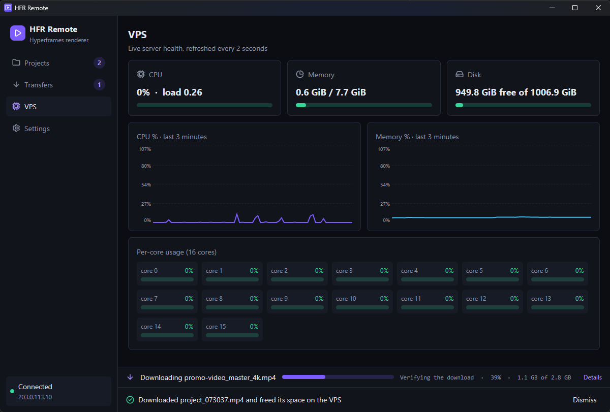
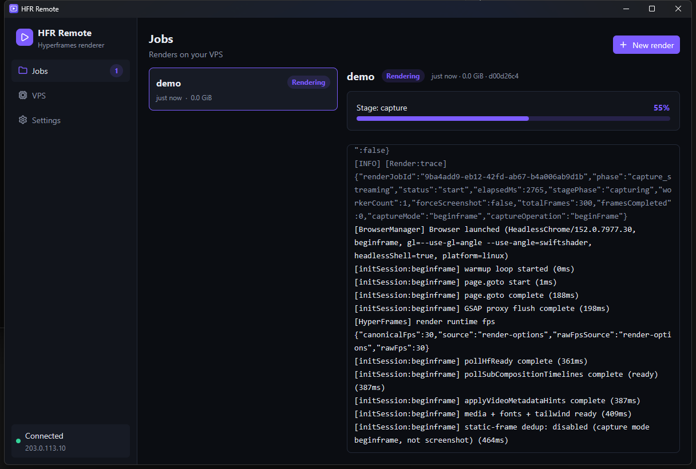
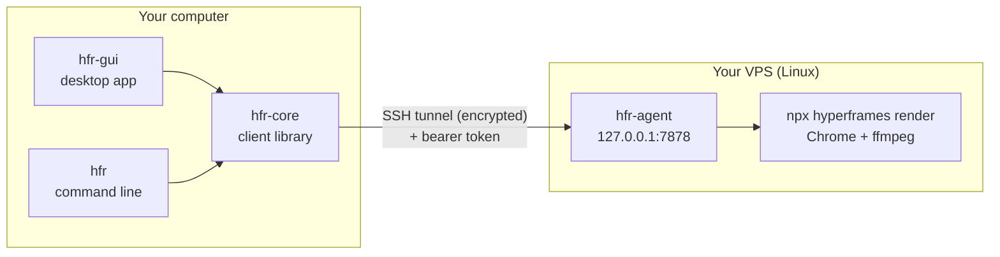

# HFR Remote

**Render big [Hyperframes](https://github.com/heygen-com/hyperframes) projects on your own VPS instead of your PC.**
Push the project, watch the render and the server's health live, download the verified video, and free the space - from a desktop app or the `hfr` command line.

<p align="center">
  
  
</p>

## Why

Long Hyperframes renders (many minutes of footage, heavy compositions) pin every CPU core and make your computer unusable. If you already have a VPS, it can do that work. HFR Remote is the missing glue: file transfer, a job runner, live logs, server metrics, and cleanup, with no ports opened on the server.

## How it works



1. **`hfr setup`** (or the app's first-run screen) installs a small agent plus Node, ffmpeg, Chrome and `hyperframes` on the VPS over SSH.
2. **Render:** pick the folder, choose options (frame rate, quality, format, workers) in a dialog, and watch the upload with speed and time left (cancellable). The agent then renders it.
3. **Watch:** logs stream live, with a progress bar and CPU / memory / disk charts of the VPS.
4. **Download and clean up:** the video comes back with a SHA-256 check, and the job folder can be deleted in the same step to free your SSD.

## Quick start

You need: Windows, macOS or Linux on your side with OpenSSH (`ssh`, `scp`), and a **Debian/Ubuntu VPS** you can SSH into as root or a user with passwordless sudo.

```bash
# 1. Load your SSH key once per login session (needed if the key has a passphrase)
ssh-add ~/.ssh/id_ed25519

# 2. One-time install on the VPS
hfr setup --host 203.0.113.10 --user root

# 3. Render a project on the VPS and follow the logs
hfr render ./my-project

# 4. Download the video and free the space on the VPS
hfr pull <job-id> --delete
```

Prefer a window? Start **HFR Remote** and follow the first-run screen. Full walkthrough: [docs/getting-started.md](docs/getting-started.md).

## Documentation

| Guide | What is in it |
| --- | --- |
| [Getting started](docs/getting-started.md) | Install, SSH key setup per OS, first render |
| [CLI reference](docs/cli.md) | Every `hfr` command and option |
| [Desktop app](docs/gui.md) | Screens and what they do |
| [Architecture](docs/architecture.md) | Crates, data flow, job lifecycle |
| [Agent API](docs/agent-api.md) | HTTP endpoints the VPS agent exposes |
| [Configuration](docs/configuration.md) | Config file, environment variables, paths on both machines |
| [Security](docs/security.md) | Threat model, controls, known limits |
| [Troubleshooting](docs/troubleshooting.md) | Common errors and fixes |
| [Development](docs/development.md) | Build, test, cross-compile, package, release |

Using an AI agent? Point it at [AGENTS.md](AGENTS.md), [llms.txt](llms.txt) and the ready-made [agent skills](skills/README.md).

## Project layout

| Crate | Binary | Role |
| --- | --- | --- |
| `crates/proto` | - | Shared data types (jobs, metrics) |
| `crates/agent` | `hfr-agent` | Service on the VPS: job runner, logs, metrics, output |
| `crates/core` | - | Client library: SSH tunnel, HTTP client, upload/download, VPS setup |
| `crates/cli` | `hfr` | Command line |
| `crates/gui` | `hfr-gui` | Desktop app ([GPUI](https://www.gpui.rs) + gpui-kit) |

## Status

Early (0.1). It works end to end on Windows with a Debian/Ubuntu VPS. macOS and Linux clients are type-checked and built in CI but less tested; see [known limitations](docs/architecture.md#known-limitations).

## Contributing and license

Contributions are welcome: see [CONTRIBUTING.md](CONTRIBUTING.md) and the [security policy](SECURITY.md).
Licensed under either of [Apache-2.0](LICENSE-APACHE) or [MIT](LICENSE-MIT) at your option.
Hyperframes is a separate project by HeyGen with its own license; HFR Remote only drives its command line.
