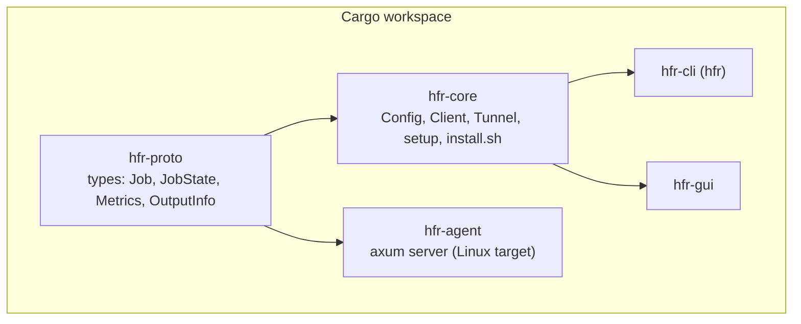
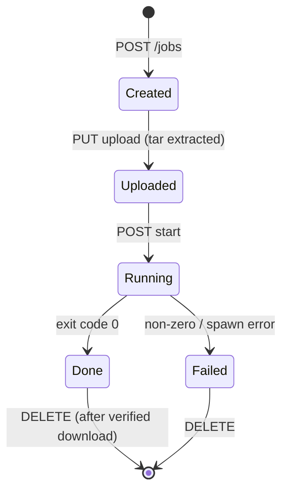

# Architecture

## Components



| Crate | Responsibility |
| --- | --- |
| `hfr-proto` | Serde types shared by both sides of the wire, plus the list of output file extensions. |
| `hfr-core` | Everything a client does: load/save `Config` (token in the OS credential store), open the SSH tunnel (`Client::connect`), call the agent's API, pack and upload a project, download and verify output, and run the one-time VPS installation (`setup::run` with `install.sh`). |
| `hfr-cli` | `clap` front end over `hfr-core`. |
| `hfr-gui` | GPUI front end over `hfr-core`; tokio runtime on the side, polling every 2 s. |
| `hfr-agent` | The VPS service: auth, job table, upload extraction, process runner, log streaming, output lookup, metrics. |

The agent and the clients only meet over the HTTP API in [agent-api.md](agent-api.md).

## Connection

1. `Client::connect` starts `ssh -N -L 127.0.0.1:<local_port>:127.0.0.1:<remote_port> user@host` (non-interactive, key from ssh-agent) and waits for the local port.
2. Requests go to `http://127.0.0.1:<local_port>` with `Authorization: Bearer <token>`; SSH carries them to the agent, which listens only on the VPS's loopback.
3. Dropping the `Client` kills the `ssh` process. On Windows, child processes are created without a console window.

`direct_url` in the config skips the tunnel; it exists for tests.

## Job lifecycle



On the VPS each job lives in `$HFR_ROOT/<uuid>/` (`/var/lib/hfr/jobs/<uuid>/`):

```
<uuid>/
  project/     the extracted upload; the command runs here
  log.txt      stdout + stderr, appended as lines arrive
```

Render options (`crates/core/src/render.rs`) are turned into the job's command (`npx hyperframes render --fps 60 -q delivery ...`) by the client; the agent only validates it against the allowlist in `crates/proto/src/command.rs`. A unit test checks that every combination the UI can offer passes that allowlist.

Output detection: when a job is `Done`, the agent picks the **newest video file** (`mp4`, `mov`, `webm`, `mkv`, `gif`) under `project/` (ignoring `node_modules`) that was modified after the job started. Hyperframes writes to `renders/` by default, so source footage in the project is never mistaken for the result.

## Upload and download

- **Upload:** the client first measures the project, then builds a tar of it (honouring `.hfrignore`, skipping `node_modules` and `.git`, no symlinks) into a temp file, then streams that file as the request body. A shared `Transfer` object (`crates/core/src/transfer.rs`) exposes the phase (measuring, packing, uploading, unpacking), bytes done and total, and a cancel token; the CLI and the app read it a few times a second and turn it into a progress bar, speed (smoothed) and time left. Cancelling stops packing or aborts the request immediately, and the caller deletes the half-created job. The agent streams the body to disk and extracts it in Rust, refusing links, devices and any path that is absolute or contains `..`.
- **Download:** `GET output/info` returns name, size and SHA-256; the client streams `GET output` into `<name>.part`, verifies size and hash, then renames. A mismatch deletes the partial file and errors out.

## Setup flow (`hfr-core::setup`)

`ssh uname -m` picks the Rust target (`x86_64` or `aarch64`, musl), the matching agent binary is found (bundled with the app, or `target/<triple>/release`), uploaded with `scp`, and `install.sh` is piped over SSH (`bash -c "$(cat)"`, so no command in the script can swallow the rest of it from stdin). The script is idempotent and prints `HFR_TOKEN=...` last, which is saved locally and never echoed.

## GUI structure

`HfrApp` (one GPUI entity) holds connection state, the job list, metric history, the selected job's log and the setup form inputs. Async work runs on a tokio runtime; results come back to GPUI through `JoinHandle`s and channels, then `cx.notify()` re-renders. `theme.rs` defines the palette and applies it over gpui-kit's dark theme.

## Known limitations

These are real, and good first contributions:

- **Job state is in memory.** Restarting `hfr-agent` forgets the job list (files stay on disk under `/var/lib/hfr/jobs`).
- **No cancel**, no queue (jobs started together run together), no timeouts.
- **Uploads and downloads are not resumable**; the download is a single stream.
- **One log stream per request:** the live log only shows lines produced after you subscribe; the full log comes from `log.txt`.
- **Debian/Ubuntu only** installer; ARM VPS support depends on Hyperframes' Chrome download being available for ARM Linux (not verified).
- Windows is the most tested client. macOS and Linux build in CI but have had little manual testing.
- Output detection is heuristic (newest video written during the job).
