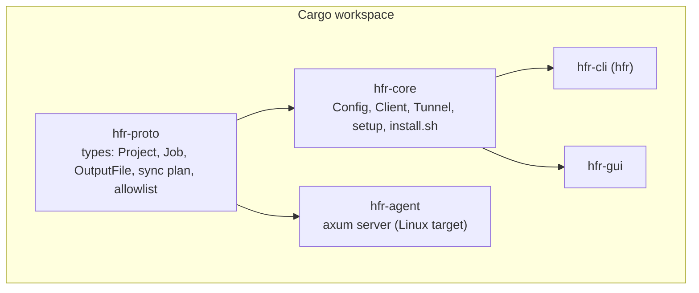
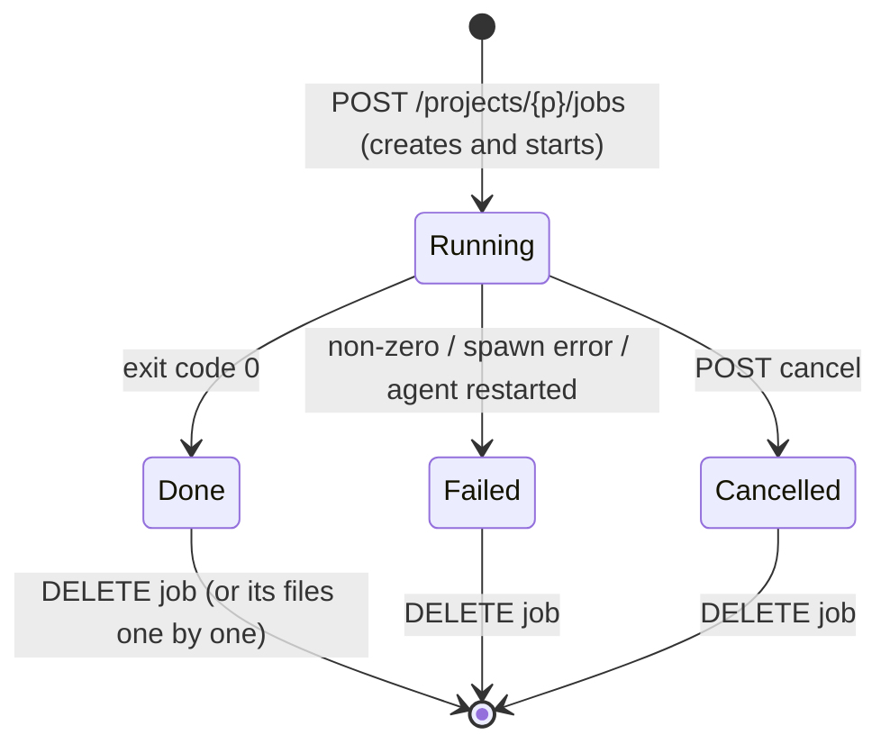

# Architecture

## Components



| Crate | Responsibility |
| --- | --- |
| `hfr-proto` | Serde types shared by both sides of the wire (`Project`, `Job`, `OutputFile`, `ProjectView`, `SyncPlan`, `Metrics`), `plan_sync` (what to upload or delete), the command allowlist and the list of output file extensions. |
| `hfr-core` | Everything a client does: `config` (token in the OS credential store), `client` (SSH tunnel and API calls), `sync` (scan, hash cache, delta upload), `registry` (which local folder is which project), `download` (resumable, verified), `transfer` (progress, speed, ETA, cancel), `render` (options to command), and the one-time VPS installation (`setup` with `install.sh`). |
| `hfr-cli` | `clap` front end over `hfr-core`. |
| `hfr-gui` | GPUI front end over `hfr-core`: `projects_view` (project list and page), `dialogs` (render options and confirmations), `transfers` (uploads and downloads), `pages` (VPS and settings). Tokio runtime on the side, polling `/overview` every 2 s. |
| `hfr-agent` | The VPS service: `store` (projects and jobs on disk, migration), `projects` (sync), `jobs` (process runner, log streaming, cancel), `files` (list, ranged download, delete), `metrics`, `safety` (tar extraction, token check). |

The agent and the clients only meet over the HTTP API in [agent-api.md](agent-api.md).

## Connection

1. `Client::connect` starts `ssh -N -L 127.0.0.1:<free local port>:127.0.0.1:<remote_port> user@host` (non-interactive, key from ssh-agent) and waits for the local port.
2. Requests go to `http://127.0.0.1:<that port>` with `Authorization: Bearer <token>`; SSH carries them to the agent, which listens only on the VPS's loopback.
3. Dropping the `Client` kills the `ssh` process. On Windows, child processes are created without a console window.

`direct_url` in the config skips the tunnel; it exists for tests.

## Data model and job lifecycle

A **project** is a folder of files on the VPS; it has any number of **jobs** (renders); a job lists the **output files** it wrote. See [agent-api.md](agent-api.md#model) for the types.



"Render again" is not a state change: it creates a **new job** in the same project, so earlier renders and their files stay available. Only one job runs per project at a time; jobs in different projects can run together (there is no queue).

On the VPS everything lives under `$HFR_ROOT` (`/var/lib/hfr/jobs`):

```
<project-id>/
  project.json     name, state and the manifest (path, size, sha256) of the synced files
  project/         the files; each render runs here
  jobs/<job-id>/
    job.json       state, command, times and the recorded output files (saved on every change)
    log.txt        stdout + stderr, appended as lines arrive
```

An agent that finds the first version's layout (`<id>/{project,log.txt,meta.json}`) migrates each folder into a project with one job at start-up, so renders survive the upgrade.

Render options (`crates/core/src/render.rs`) are turned into the job's command (`npx hyperframes render --fps 60 -q delivery ...`) by the client; the agent only validates it against the allowlist in `crates/proto/src/command.rs`. A unit test checks that every combination the UI can offer passes that allowlist. Going the other way, `RenderOptions::from_command` reads the options back from a job's command, which is how "render again with changes" pre-fills the dialog.

**Output detection:** when a job ends, the agent records the video files (`mp4`, `mov`, `webm`, `mkv`, `gif`) under `project/` (ignoring `node_modules`) whose modification time lies inside the job's start..finish window. Because only one job runs per project, those files belong to that job. Source footage in the project is never mistaken for a result, and an earlier render's files are not claimed by a later one. SHA-256 is computed once, in the background, after the job ends.

## Syncing, uploading and downloading

- **Sync (upload):** the client scans the folder (honouring `.hfrignore`, skipping `node_modules` and `.git`, no symlinks) and hashes each file; hashes are cached by (path, size, modified time) so a multi-GB folder is not re-read on every sync. It sends that manifest to `POST sync/plan`; the agent answers which files to upload and which synced files no longer exist locally. Only the needed files are packed into a tar (temp file, then streamed) and sent with `PUT sync`; then `POST sync/delete` removes deleted files. The first upload is simply a sync into an empty project; syncing an unchanged folder uploads 0 bytes. A shared `Transfer` object (`crates/core/src/transfer.rs`) exposes the phase, bytes done and total and a cancel token; the CLI and the app turn it into a progress bar, smoothed speed and time left. Cancelling aborts at once; files that already arrived stay and are skipped next time. The agent streams the body to disk and extracts it in Rust, refusing links, devices and any path that is absolute or contains `..`.
- **Which folder is which project:** `registry.rs` stores `projects.json` in the config folder, mapping a canonical local folder path to a project id. Two folders with the same name are two projects; picking a known folder again asks whether to sync it, render, open it or create a separate project.
- **Download:** the client streams `GET file?path=...` into `<name>.hfrpart`, with a small sidecar (`.hfrpart.json`) recording the expected size and SHA-256. If it is interrupted or paused, the next attempt sends `Range: bytes=<part size>-` and continues. At the end the file is hashed and compared with the agent's checksum before it is renamed into place; a mismatch deletes the partial file and errors out. The final name never overwrites an existing file (`name (1).mp4`). Optionally the VPS copy is deleted afterwards, but only after a successful verification.

## Setup flow (`hfr-core::setup`)

`ssh uname -m` picks the Rust target (`x86_64` or `aarch64`, musl), the matching agent binary is found (bundled with the app, or `target/<triple>/release`), uploaded with `scp`, and `install.sh` is piped over SSH (`bash -c "$(cat)"`, so no command in the script can swallow the rest of it from stdin). The script is idempotent and prints `HFR_TOKEN=...` last, which is saved locally and never echoed.

## GUI structure

`HfrApp` (one GPUI entity) holds connection state, the projects with their jobs (from `/overview`), the registry, metric history, the selected render's log, the list of transfers and the open dialog. Async work runs on a tokio runtime; results come back to GPUI through `JoinHandle`s and channels, then `cx.notify()` re-renders. Screens: **Projects** (list, then a project page with its renders and a Files | Log view), **Transfers** (every upload and download with percentage, bytes, speed, time left, pause/resume/cancel) with a compact bar above the status line on other pages, **VPS** and **Settings**. Anything destructive goes through a confirmation dialog that names what will be removed. `theme.rs` defines the palette and applies it over gpui-kit's dark theme; `accent_text()` is the lighter violet used for text (contrast 4.5:1).

On Windows the executable is linked with a 16 MB main-thread stack (`crates/gui/build.rs`): debug builds of GPUI need more than the default 1 MB.

## Known limitations

These are real, and good first contributions:

- **No queue and no timeouts:** jobs in different projects started together run together, and a runaway render keeps running until you cancel it.
- **A render that was running when the agent stopped is marked failed** (its process died with the agent); finished jobs and their files are kept.
- **Uploads are not resumable mid-file:** a cancelled or failed sync is re-run and skips files that already arrived, but a single huge file restarts. Downloads do resume.
- **One log stream per request:** the live log only shows lines produced after you subscribe; the full log comes from `log.txt`.
- **Debian/Ubuntu only** installer; ARM VPS support depends on Hyperframes' Chrome download being available for ARM Linux (not verified).
- Windows is the most tested client. macOS and Linux build in CI but have had little manual testing.
- Output files are attributed by modification time; a render that writes a video outside the project folder is not seen.
