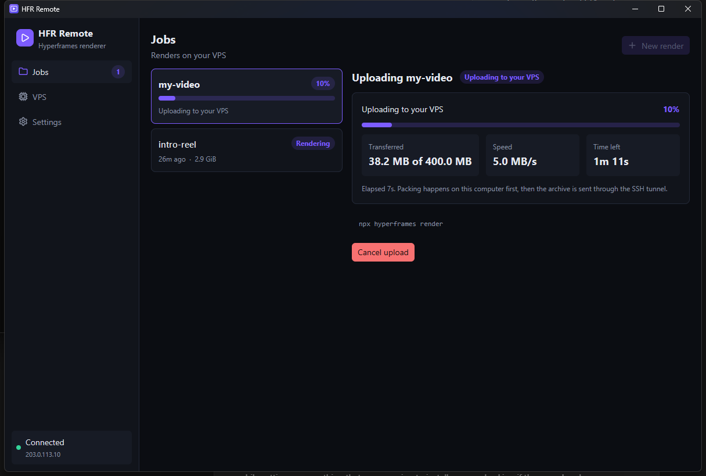

# Desktop app: HFR Remote

`hfr-gui` is a native app (GPUI) with the same abilities as the CLI plus live dashboards. It uses the same saved connection as `hfr`, and both can be used side by side.

## First run

With no saved connection the app shows **Connect your VPS**: enter the host, the SSH user (root, or a user with passwordless sudo) and optionally a key file, then **Install and connect**. A log shows each installer step. Requirements are the same as for `hfr setup`; your SSH key must be loaded in ssh-agent ([guide](getting-started.md#2-let-hfr-use-your-ssh-key)).

## Sidebar

| Item | Shows |
| --- | --- |
| **Jobs** | Every render on the VPS, with a count badge |
| **VPS** | Live server health |
| **Settings** | Connection details, where the token is stored, upgrade/reinstall of the agent |
| Connection badge (bottom) | Green *Connected*, red *Offline*, or grey *Set up*, with the host |

## Jobs

- **New render** walks through three steps:
  1. Pick the Hyperframes project folder.
  2. A **Render options** dialog opens with every field preset to Hyperframes' defaults: composition (only when the project has other HTML files), frame rate, quality, format, colour range (auto / HDR / SDR) and parallel workers (with a hint about the VPS's cores and RAM). A live line shows the exact command that will run. **Upload and render** continues; **Cancel** closes it.
  3. The job is created and the project is packed and uploaded. The job list gets an upload card and the right pane shows a **progress bar** with *transferred / total*, **speed**, **time left** and elapsed time. **Cancel upload** stops it at any moment (while packing or sending); the half-created job is deleted from the VPS so nothing is left behind. When the last byte is sent the VPS unpacks the project and the render starts automatically, switching to the live progress view.

  
  

- The list shows name, state pill (Created, Ready, Rendering, Done, Failed), age and size. Click a job to open it.
- The detail pane has a **progress bar** with the current stage (parsed from Hyperframes' progress output) while rendering, then the **live log** (errors in red, warnings in amber, noisy progress lines hidden).
- **Download video** saves to your Downloads folder after verifying size and SHA-256. Keep **Free VPS space after download** ticked to delete the job on the VPS in the same step.
- **Delete** needs a second click (**Really delete?**). It is disabled while a job is running.
- A status bar at the bottom reports results and errors; dismiss it with **Dismiss**.

## VPS

Refreshed every 2 seconds:

- Meters for CPU (with load average), memory and disk (free space), coloured green below 70%, amber to 90%, red above.
- Line charts of CPU % and memory % for roughly the last three minutes.
- One bar per CPU core.

## Settings

Shows host, user, "SSH tunnel to 127.0.0.1 only", where the token is kept (Windows Credential Manager, macOS Keychain, or an owner-only config file on Linux) and the config file path. **Upgrade agent** re-runs the installer, keeping your token and jobs.

## Notes

- The app refreshes while open; closing it does not stop renders on the VPS.
- The window needs a GPU driver with Vulkan/DirectX 12/Metal support (a requirement of GPUI).
