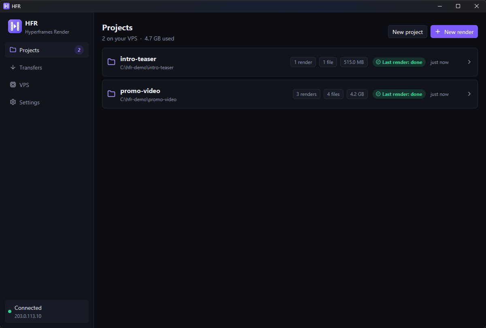
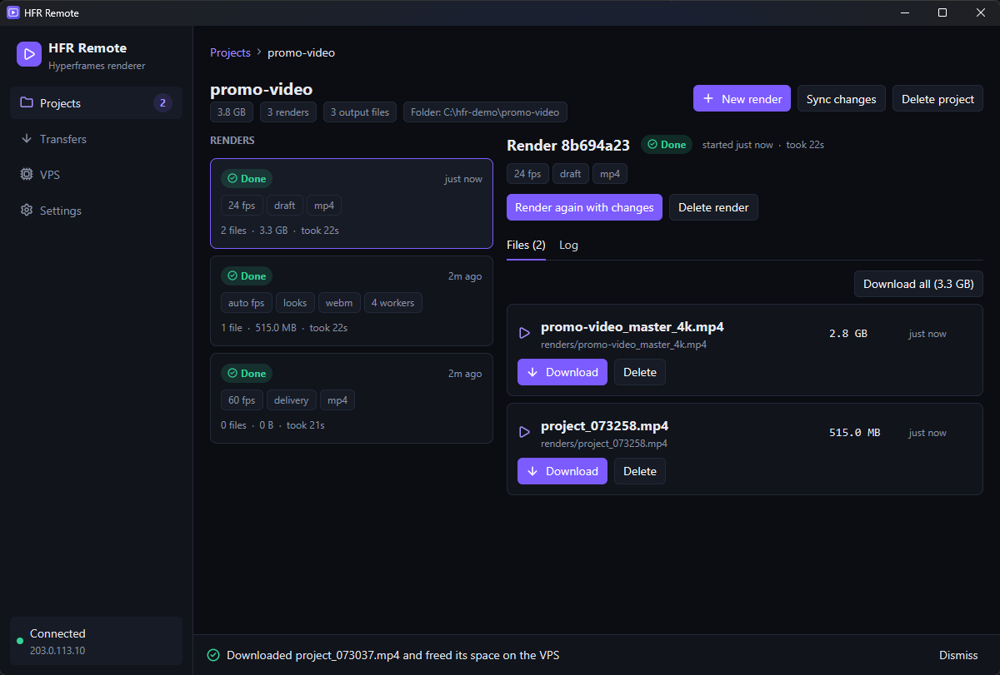
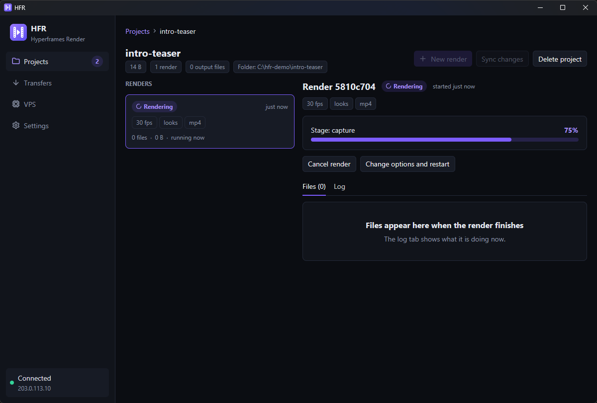
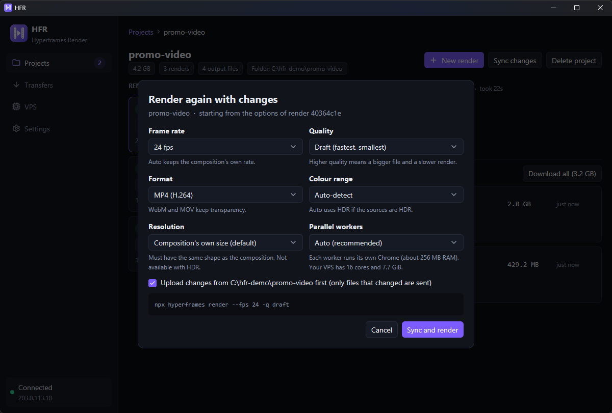
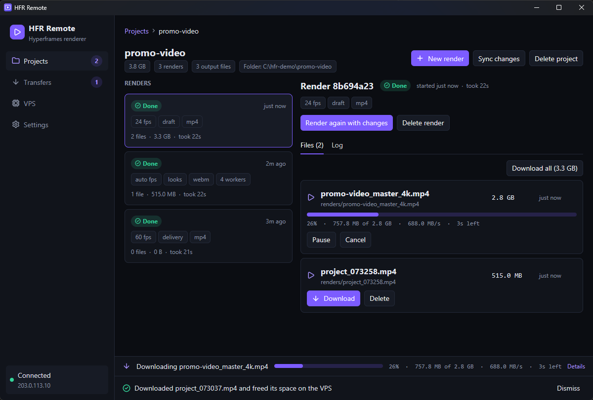

# Desktop app: HFR Remote

`hfr-gui` is a native app (GPUI) with the same abilities as the CLI plus live dashboards. It uses the same saved connection and the same list of known folders as `hfr`, and both can be used side by side. It needs agent API 2: if your VPS still runs an older agent the app says so and offers **Upgrade agent** in Settings (see [troubleshooting.md](troubleshooting.md)).

## First run

With no saved connection the app shows **Connect your VPS**: enter the host, the SSH user (root, or a user with passwordless sudo) and optionally a key file, then **Install and connect**. A log shows each installer step. Requirements are the same as for `hfr setup`; your SSH key must be loaded in ssh-agent ([guide](getting-started.md#2-let-hfr-use-your-ssh-key)).

## How things are organised

A **project** is a Hyperframes folder on your VPS. A project has any number of **renders**, each with its own options, log and list of **output files**. You upload a project once; after that only files you changed are sent, so trying another frame rate or quality costs no upload.

```
Projects
 `- promo-video            (the folder C:\...\promo-video)
     |- Render 03d91877    60 fps · delivery · mp4      2 files
     |    |- intro.mp4         Download  Delete
     |    `- teaser.mp4        Download  Delete
     `- Render d46478c3    auto fps · looks · webm      1 file
```

## Sidebar

| Item | Shows |
| --- | --- |
| **Projects** | Every project on the VPS, with a count badge |
| **Transfers** | Uploads and downloads, with the number that are active |
| **VPS** | Live server health |
| **Settings** | Connection details, download folder, upgrade/reinstall of the agent |
| Connection badge (bottom) | Green *Connected*, red *Offline*, or grey *Set up*, with the host |

## Projects

<p align="center">
  
</p>

The list shows each project's name, the local folder it came from, its number of renders and files, its size, a state pill (Rendering, Ready, Failed, ...) and when it last changed. Two projects may have the same name; the folder path tells them apart.

- **New project** picks a folder, asks for a name and uploads it without rendering.
- **New render** picks a folder, asks for the options and uploads and renders in one go.
- **Picking a folder you used before** shows *This folder is already a project*: **Sync changes** (or **Render**), **Open project**, or **Create a separate project**. Nothing is uploaded twice.

## A project's page

<p align="center">
  
</p>

The breadcrumb (*Projects › name*) takes you back. The header shows the size, number of renders and files and the local folder, with **New render**, **Sync changes** and **Delete project**.

- **Renders** (left): one card per render with its state, option chips (`60 fps · delivery · mp4`), age and duration. Click one to open it.
- **Render details** (right): a progress bar with the current stage while rendering, then two tabs:
  - **Files**: one row per output file with its size and age, a **Download** button and a **Delete** button. **Download all** fetches every file of the render.
  - **Log**: the live log (errors in red, warnings in amber, noisy progress lines hidden).
<p align="center">
  
</p>

- **Cancel render** (while rendering) asks for confirmation, then stops the render and everything it started on the VPS. The render becomes *Cancelled* and the project stays.
- **Change options and restart** (while rendering) and **Render again with changes** (finished render) open the **Render options** dialog pre-filled with that render's options. It creates a *new* render, so earlier ones and their files stay. By default it first syncs your local folder (only changes are sent); untick that to render with the files already on the VPS. For a running render the dialog says the frames rendered so far are discarded. Options the dialog does not offer (for example a hand-written `--crf 14`) are kept unchanged.
- **Delete render** and **Delete project** are not offered while something is running.

### Render options

<p align="center">
  
</p>

Composition (only when the project has other HTML files), frame rate, quality, format, colour range (auto / HDR / SDR), **resolution** (the composition's own size, or 1080p / 4K in landscape, portrait or square; the shape must match the composition and it cannot be combined with forced HDR, which the dialog points out) and parallel workers (with a hint about the VPS's cores and RAM). Every field starts at Hyperframes' default. A live line shows the exact command that will run.

## Deleting

Every delete opens a dialog that says exactly what will be removed and from where, with the safe choice (**Keep it**) first and highlighted:

| You delete | What goes | What stays |
| --- | --- | --- |
| A file | That video on the VPS | The render, its other files, the project |
| A render | Its log and all its files on the VPS | The project and its other renders |
| A project | All its files and renders on the VPS | Your local folder |

Nothing on your computer is ever deleted by these buttons.

## Transfers

<p align="center">
  
</p>

Uploads (syncs) and downloads share one page and, on every other page, a compact bar above the status line. Each row shows the title, a progress bar and a line such as:

```
62%  ·  1.2 GB of 2.0 GB  ·  38.0 MB/s  ·  21s left
```

Numbers use a monospaced font so they do not jitter. Phases before and after the transfer itself (*Comparing files with the VPS*, *Packing changed files*, *Unpacking on the VPS*, *Verifying the download*) are named instead of showing a stuck bar.

| State | Buttons |
| --- | --- |
| Running download | **Pause**, **Cancel** (deletes the partial file) |
| Paused download | **Resume** (continues where it stopped), **Discard** |
| Running upload | **Cancel** (files already sent stay and are not sent again) |
| Failed | **Resume** / **Try again**, **Dismiss** |
| Done | **Show in folder**, **Dismiss** (an upload also offers **Open project**) |

Downloads are written to `<download folder>/<project name>/`, resume after a lost connection or a restart of the app, are checked against the VPS's SHA-256 before the final file appears, and **never overwrite** an existing file (the new one becomes `name (1).mp4`).

## VPS

Refreshed every 2 seconds:

- Meters for CPU (with load average), memory and disk (free space), coloured green below 70%, amber to 90%, red above.
- Line charts of CPU % and memory % for roughly the last three minutes.
- One bar per CPU core.

## Settings

- **Your VPS**: host, user, "SSH tunnel to 127.0.0.1 only", where the token is kept (Windows Credential Manager, macOS Keychain, or an owner-only config file on Linux) and the config file path.
- **Downloads**: the folder downloads go to (default `Downloads/HFR Remote`), with **Browse** and **Save**, and **Delete a file from the VPS after it was downloaded and verified** (on by default; only a verified file is ever deleted).
- **Upgrade or reinstall the agent**: re-runs the installer, keeping your token and projects. It never interrupts a running render.

## Updates

On start-up and then at most once an hour the app asks GitHub whether a newer version exists (switch this off in **Settings > About and updates**, where **Check now** also lives). When there is one, a banner appears on every page: **Update now**, **What's new** (release notes), **Skip this version**, **Later**. **Update now** downloads the installer with a progress bar (percentage, speed, time left, Cancel), checks the signed checksums and the installer's SHA-256, and then offers **Restart and install** (Windows: the app closes, the installer runs silently and the app starts again; macOS and Linux open the verified file). Nothing is installed without that last click. Details: [security.md](security.md#updates).

If the agent on your VPS is older than the app but still compatible, a softer banner offers **Upgrade agent**. An app update does not force a VPS upgrade unless the protocol changed.

## Notes

- The app refreshes while open; closing it does not stop renders on the VPS. Downloads and uploads stop when you close it (a download resumes next time; a sync skips what already arrived).
- The window needs a GPU driver with Vulkan/DirectX 12/Metal support (a requirement of GPUI).
